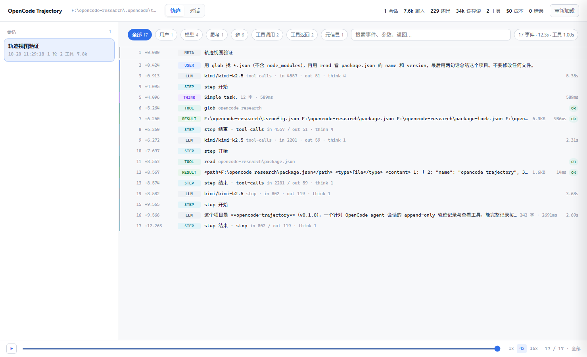
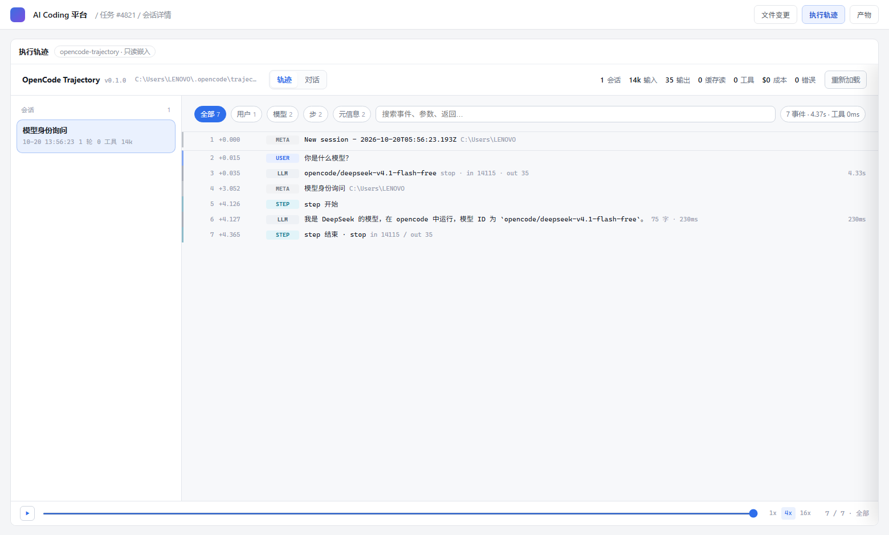

# opencode-trajectory

An **append-only trajectory recorder** for [OpenCode](https://opencode.ai), plus a zero-dependency offline viewer. Every turn, every tool call, every payload, every millisecond and every token — written to disk, replayable frame by frame.

[中文文档](./README.zh-CN.md) · [Integration guide](./INTEGRATION.md) (中文)



```
.opencode/trajectory/
├── _boot.json / _boot.log          startup evidence (is the plugin actually loaded)
└── sessions/
    ├── ses_abc123.jsonl            one append-only journal per session
    └── ses_abc123.1.jsonl          auto-rotates past 16MB
```

---

## Why

OpenCode ships sessions, `opencode debug`, share links and parent/child agent navigation, but no single timeline that shows **payload + duration + tokens + origin** together. Answering "what exactly did that `bash` call at step 7 receive, what did it return, and why did it take 4 seconds" means stitching several views together by hand.

DeepSeek Harness solves this at the framework level. This project does **side-channel recording** instead: subscribe to OpenCode's public event stream, rebuild it as an isomorphic append-only journal, render it in a static page.

### Honest gap vs. DSH

| | DSH | This plugin |
|---|---|---|
| append-only event journal | native | rebuilt from the `event` hook |
| messages / tools / sub-agents / retries / permissions | yes | yes |
| per-step payload and duration | yes | yes (`ToolPart.state.time`) |
| filter by origin | yes | yes (user / assistant / tool / system / harness) |
| fork and replay from any node | yes | no — only marks resume anchors (`snapshot` / `messageID`) |
| raw LLM request body, full context snapshot | yes | no — not reachable from the plugin layer |
| embed a panel inside the TUI | yes | no — no UI injection point (`PluginModule.tui: never`) |

So: **post-mortem replay + external visualization, yes. Interactive forking inside the framework, no.** Use DSH if you need real forks; use this if you want to stay in OpenCode and see through the run.

---

## Why the `event` hook, not `tool.execute.before/after`

The most common design mistake here deserves its own section.

| | `event` | `tool.execute.before/after` |
|---|---|---|
| `messageID` / `partID` available | yes | no — only `sessionID` + `callID`, cannot align to the message tree |
| full tool output | yes, `ToolPart.state.output` | no — `output` is missing on the error path |
| tool duration | yes, `state.time.start/end` | must time it yourself |
| permission prompts / retries / compaction / sub-agents | yes | no |
| intrusiveness | **zero** — read-only subscription, never mutates `output` | must never throw, or it interrupts tool execution |

So there are exactly two hooks:

```ts
event          // the single source of truth, read-only
chat.message   // authoritative user-turn timing (stable messageID, dedup vs. event stream)
```

`tool.execute.before/after` are unused. If the plugin crashes, your session is unaffected — every hook is wrapped in try/catch and reports at most once via `client.app.log`.

---

## Install

Requires Node 18+ and OpenCode 1.18+.

```bash
# global: applies to every opencode instance on this machine
node scripts/install.mjs

# project-level only
node scripts/install.mjs --project

# explicit plugin directory (containers, custom layouts)
node scripts/install.mjs --dir /opt/opencode-plugins
```

**Restart opencode afterwards** — plugins load once at startup.

Or declare it in `opencode.json`:

```json
{
  "plugin": [
    ["opencode-trajectory", { "dir": "/data/trajectory" }]
  ]
}
```

Do not combine auto-discovery with a `plugin` entry — pick one, or every record is written twice.

Prebuilt zip (no npm account needed): unzip, then run `scripts/install.mjs` from inside the folder.

---

## Usage

Record: do nothing. The plugin attaches itself and writes to `<workdir>/.opencode/trajectory/`.

Inspect:

```bash
node bin/cli.mjs serve --open          # local viewer (port 7777)
node bin/cli.mjs stats                 # terminal summary: turns, tokens, cost, slowest tools
node bin/cli.mjs list                  # sessions
node bin/cli.mjs export --session <id> --out trace.html   # self-contained single file
node bin/cli.mjs path                  # which directory is it reading?
```

A `traj` shortcut is available after `node scripts/install-cli.mjs`:

```bash
traj            # serve + open browser, resolves the journal dir upward from cwd
traj stats
traj list
traj export --session ses_xxx --out t.html
```

### The viewer

Two projections of the same journal:

- **Trajectory** (default) — a single-line-per-event audit stream. Sequence number, relative timestamp (`+4.236s`), origin rail and tag, content, secondary note, duration, status. Twelve origins: user, assistant, reasoning, step, tool call, tool result, context, sub-agent, error, permission, file, meta.
- **Chat** — the conventional message/bubble reading view.

Interaction: click any row for a drawer with locating IDs (`messageID` / `partID` / `callID`), the originating event name, the payload as a collapsible JSON tree, and fork anchors. Chips filter by origin; the search box indexes content, arguments, output and IDs. The bottom bar replays the session on the real timeline at 1x / 4x / 16x.

Tool calls are split into **call** and **result** rows — the gap between them is the tool's actual latency, which is usually the reason you opened the log.

---

## What gets captured

| Origin | Data |
|---|---|
| session | id, parentID (agent tree), title, directory |
| message | role, agent, provider/model, tokens (input/output/reasoning/cache read+write), cost, finish reason, error |
| text / reasoning | streamed deltas with prefix diffing (`r:1` = reset), `syn:1` = injected context |
| tool | name, callID, input, output, exit status, start/end timestamps |
| step | model-step boundaries with token and cost snapshots, snapshot anchor |
| error / retry | name, message, attempt, next retry |
| permission | request id, title, type |
| file | path, diff |
| subtask | sub-agent name, prompt, spawned session id |

---

## Config

All optional, passed as the plugin's second array element.

| Key | Default | |
|---|---|---|
| `dir` | `.opencode/trajectory` | output directory; absolute paths supported |
| `enabled` | `true` | master switch (useful in CI) |
| `captureText` / `captureReasoning` | `true` | |
| `captureToolInput` / `captureToolOutput` | `true` | |
| `maxPayloadChars` | `20000` | head 70% + tail 30% |
| `maxInputChars` | `4000` | |
| `flushMs` | `250` | write throttle |
| `maxFileBytes` | `16777216` | rotation threshold |
| `redact` | `true` | **keep enabled in production** |
| `redactPatterns` | `[]` | extra regexes (strings) for business-specific secrets |
| `debug` | `false` | |

---

## Privacy

- **No network egress.** No telemetry, no OTLP, no external service. Local files only.
- **Redaction on by default.** `sk-*`, `gh*_`, AWS, Google, Bearer tokens, JWTs and URL credentials become `***REDACTED***` (a short prefix is kept so you can still tell the type).
- **Payload truncation** at 20KB.
- Journals contain prompts, model output and tool results — **possibly your business data**. Retention and location are your call; the plugin never deletes (`append-only`).

---

## Performance

Buffered appends at 64KB / 250ms, synchronous `appendFileSync` per flush (sub-millisecond), rotation at 16MB. A 100-turn session lands around 1–3MB. Worst case on `kill -9` is losing the last 250ms.

---

## Data format

UTF-8 JSONL, one record per line, `append-only`. Common fields: `v` (schema), `seq`, `ts`, `sid`, `k` (kind), `ev` (originating event name). Full field reference, folding rules and integration patterns: [INTEGRATION.md](./INTEGRATION.md).

```jsonc
{"v":1,"seq":41,"ts":1761000000000,"sid":"ses_abc","k":"tool","pid":"prt_1","mid":"msg_2",
 "callID":"call_7","tool":"bash","st":"completed","input":{"command":"npm test"},
 "output":"...","t0":1760999999120,"t1":1760999999790,"ev":"message.part.updated"}
```

`src/fold.js` contains the reference folding implementation (`fold()` → message tree, `trajectory()` → event stream) and is shared verbatim by the CLI and the browser.

---

## Integration

Embedding this into your own platform (including a product that bundles OpenCode)? See **[INTEGRATION.md](./INTEGRATION.md)** — three integration shapes (iframe, single-file export, read-the-JSONL-yourself), embedded-OpenCode deployment, multi-tenant storage, and a verified/unverified checklist.



---

## Limits

- No forking. Records carry `snapshot` and `messageID` anchors, but executing a fork is a write operation — out of scope for a read-only recorder.
- No raw LLM request bodies or full context snapshots (not exposed to plugins).
- No TUI panel (the plugin API forbids UI injection).
- Verified against OpenCode 1.18.26 on Windows. Other versions and platforms are plausible but untested — see INTEGRATION.md §7.

---

## Development

```bash
npm install
npm test         # 30 tests: diffing, dedup, redaction, truncation, rotation, event projection, jsdom viewer render
npm run typecheck
npm run build    # esbuild → dist/opencode-trajectory.js (single file; OpenCode only loads top-level files)
npm run demo     # generate a demo journal through the real Normalizer + Store
```

Layout:

| Path | Role |
|---|---|
| `src/types.ts` | record schema (the contract) |
| `src/normalize.ts` | events → records: prefix diffing, dedup, state machine |
| `src/store.ts` | JSONL writer: 64KB/250ms buffering, 16MB rotation, crash safety |
| `src/redact.ts` | redaction + truncation |
| `src/fold.js` | records → trajectory tree (shared by CLI and browser) |
| `src/index.ts` | plugin entry (singleton guard, full try/catch isolation) |
| `viewer/index.html` | the viewer |

---

## License

MIT
